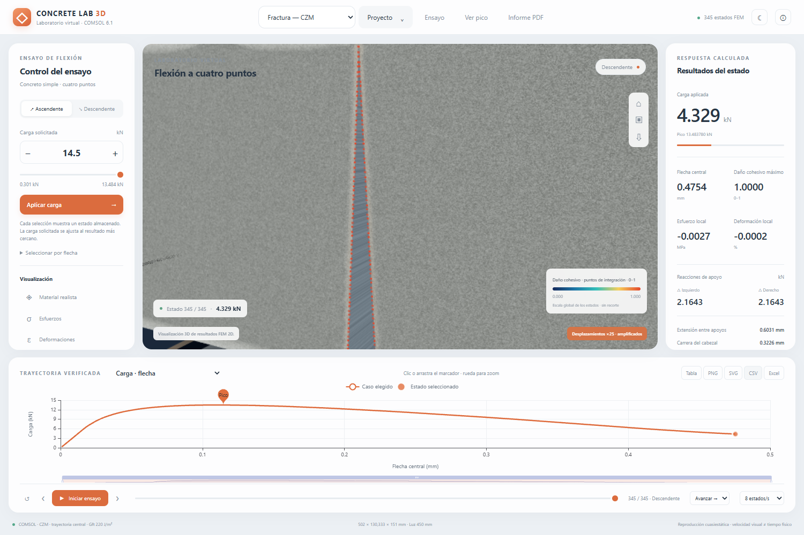

# CONCRETE LAB 3D

[](https://github.com/frankrac123/visualizador-de-comsol-de-ensayos-vigueta/actions/workflows/ci.yml)

**Visualizador interactivo de un ensayo de flexión de una vigueta de concreto simple, calculado en COMSOL.**

Explora esfuerzos, deformaciones, flecha, daño y apertura de una interfaz de fractura. Compara dos modelos físicos y exporta gráficas, tablas e informes.

**[Descargar el programa para Windows](https://github.com/frankrac123/visualizador-de-comsol-de-ensayos-vigueta/releases/tag/v2.0.0)** · [Cómo usarlo](docs/COMO_EMPEZAR.md) · [Informe científico](docs/ciencia/INFORME_CIENTIFICO_ETAPA_II.pdf) · [Alcance físico](docs/ALCANCE_CIENTIFICO.md)



## Abrir el programa — sin instalar COMSOL

1. Entra en **[Releases](https://github.com/frankrac123/visualizador-de-comsol-de-ensayos-vigueta/releases/tag/v2.0.0)**.
2. Descarga **CONCRETE_LAB_3D_Etapa_II_Windows_x64.zip** (215 MB).
3. Extrae **todo** el ZIP en una carpeta.
4. Abre **CONCRETE_LAB_3D_ETAPA_II/ABRIR_LAB.bat**.
5. Selecciona **Mazars**, **Fractura — CZM** o **Comparación científica**.

El programa incluye los datos. No requiere internet, COMSOL, Python ni Node.js para visualizar los estados guardados. Conserva las carpetas extraídas junto al ejecutable. El botón verde **Code → Download ZIP** descarga el código; el ejecutable está en **Releases**.

## Qué incluye

| Modelo | Estados almacenados | Qué representa |
|---|---:|---|
| A · Mazars | 127 | Daño continuo; pico de 14,508 kN |
| B · Fractura CZM | 345 | Interfaz central cohesiva con caras independientes; pico de 13,484 kN |

Los mapas, posiciones, curvas y tablas cambian conjuntamente al seleccionar un estado. La apertura CZM proviene del salto de desplazamientos FEM entre caras. Se pueden exportar PNG, SVG, CSV, Excel y PDF.

**Alcance:** solución mecánica **2D**, visualizada mediante extrusión **3D**. La trayectoria CZM está prescrita y el volumen es elástico, sin aplastamiento. El estado final conserva un ligamento que transmite carga. No se dispone de una curva experimental sincronizada para validar la trayectoria completa.

Esta versión reproduce soluciones calculadas: cambiar el estado en pantalla no ejecuta un ensayo nuevo en COMSOL. Los scripts científicos se ejecutan por separado y requieren COMSOL 6.1 con la licencia correspondiente.

## Para desarrollar

Requisitos: **Node.js 24 LTS** y npm. Desde la carpeta del repositorio:

```sh
git clone https://github.com/frankrac123/visualizador-de-comsol-de-ensayos-vigueta.git
cd visualizador-de-comsol-de-ensayos-vigueta
npm ci
npm run dev
```

Abre la dirección local que indique Vite. Los datos científicos del visor ya están incluidos en `public/data/` (aproximadamente 78 MiB).

```sh
npm test          # integridad, unidades y consistencia científica
npm run build    # TypeScript y compilación de producción
npm run desktop  # abrir Electron después de compilar
```

[Instalación, pruebas UI y empaquetado](docs/DESARROLLO.md) · [Reproducir los cálculos COMSOL](comsol/README.md)

## Dónde está cada cosa

| Carpeta | Contenido |
|---|---|
| `src/` | Interfaz React, escena Three.js, gráficas y exportadores |
| `desktop/` | Aplicación de escritorio Electron |
| `public/data/` | Mallas, campos y series calculadas; A y B separados |
| `comsol/` | Scripts Python/API Java, modelo Java y resultados de referencia |
| `tests/` | Pruebas de datos e interacción |
| `scripts/` | Herramientas de empaquetado y comprobación |
| `docs/` | Guías, informe, formulación, imágenes y evidencias |

Los modelos MPH y las instalaciones de COMSOL permanecen en el proyecto científico original. No se incluyen dependencias instaladas, cachés, temporales ni ejecutables en el historial Git. La aplicación completa se distribuye en Releases.

## Verificación y límites

La entrega original pasó 15 pruebas científicas, cinco de interfaz y una prueba del ejecutable. En esta edición del repositorio, `npm test` añade hashes de todos los datos y utiliza una extracción JSON independiente. Las dos comprobaciones que necesitan los MPH originales se omiten explícitamente cuando no se define `COMSOL_PROJECT_DIR`; [aquí se explica cómo ejecutarlas](docs/DESARROLLO.md).

Se calcularon tres mallas CZM (8, 6 y 4 mm), variantes de parámetros y probetas independientes. La dispersión entre picos de las tres mallas fue de aproximadamente 0,25 %. Esto es verificación numérica del modelo implementado, no validación experimental del concreto real.

[Manual de uso](docs/ciencia/MANUAL_USO.md) · [Informe completo](docs/ciencia/INFORME_CIENTIFICO_ETAPA_II.pdf) · [Procedencia de los datos](docs/PROCEDENCIA.md)

## Autoría y dependencias

Proyecto publicado por **frankrac123**. Todavía no se ha elegido una licencia de redistribución del código propio. Las dependencias conservan sus licencias; el paquete Electron incluye sus avisos. COMSOL es software comercial y su licencia no se distribuye con este proyecto.
