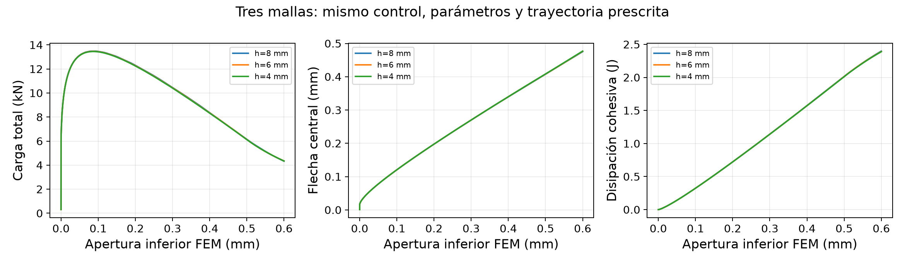
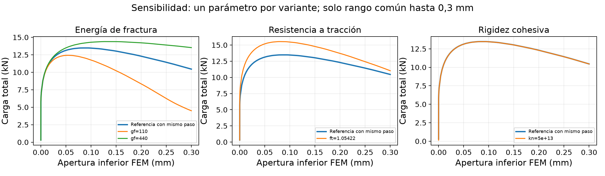
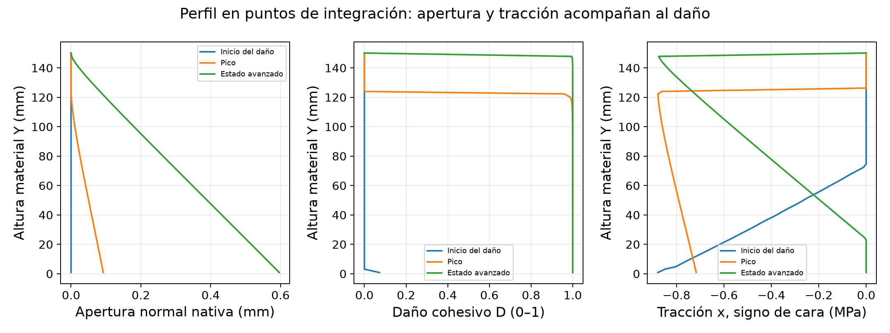
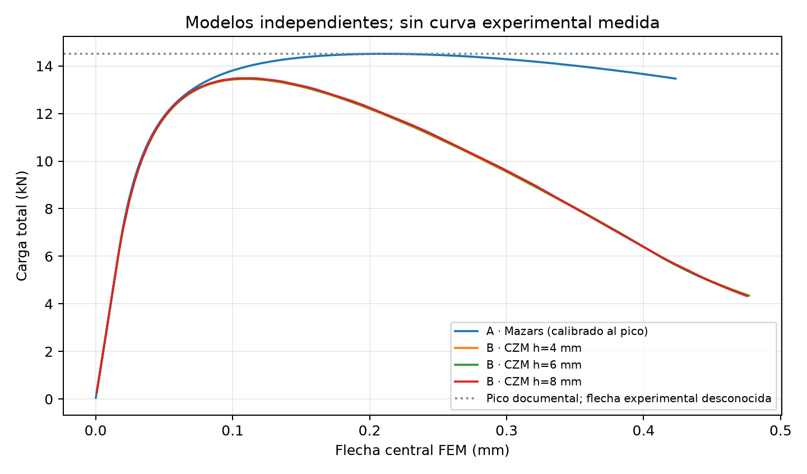

# CONCRETE LAB 3D - Etapa II
## Fractura cohesiva, verificación e integración
Fecha: 10 de octubre de 2026. COMSOL 6.1.0.282.

Informe técnico de verificación numérica y laboratorio virtual. Ensayo de una vigueta de concreto simple en flexión a cuatro puntos.

Continuación del proyecto existente. Modelo A: Mazars preservado. Modelo B: interfaz cohesiva nativa COMSOL con separación entre caras calculadas.

Clasificación: prototipo académico con verificaciones numéricas. No validado experimentalmente. Mecánica 2D en tensión plana; visualización por extrusión 3D.

| Indicador | Resultado |
| --- | --- |
| Estados visualizados | 127 Mazars + 345 CZM |
| Pico CZM | 13.483780 kN |
| Último estado CZM | 4.328622 kN; apertura inferior 0.600 mm |
| Balance energético CZM | Máximo desbalance relativo 0.0717 % |
| Refinamiento | Tres mallas: 8, 6 y 4 mm |
| Límites físicos | Trayectoria central prescrita; volumen elástico sin aplastamiento |

Los números de este informe se leen de las soluciones y comprobaciones ejecutadas. El acumulador explícito original se conserva como diagnóstico; no se alteraron los campos de desplazamiento ni las soluciones nativas para ajustar la energía.

## 1. Resumen

Se implementó y resolvió una zona cohesiva bilineal con daño irreversible y contacto de cierre en COMSOL 6.1. La trayectoria de 345 estados alcanza un pico de 13.483780 kN y termina en 4.328622 kN, con pérdida del 67.90 % y apertura inferior de 0,6 mm. Las superficies mantienen grados de libertad independientes. La aplicación reproduce resultados almacenados y sincroniza campos, máquina, curvas y tablas.

Se verificaron ley constitutiva, tracción, compresión elástica, descarga-recarga, tres mallas de cupón y vigueta, contacto unilateral, equilibrio y energía. La verificación no elimina las hipótesis materiales ni demuestra una trayectoria de fractura libre o rotura completa.

## 2. Introducción

El proyecto inicial reproduce daño continuo de Mazars regularizado. Ese campo permite estudiar degradación y concentración de deformaciones, pero no define dos caras con un salto físico de desplazamientos. Esta etapa incorpora una formulación independiente para estudiar abertura y disipación sobre una interfaz central, conservando la referencia original.

## 3. Objetivos

Calcular inicio del daño cohesivo, avance sobre la trayectoria prescrita, separación entre caras, respuesta posterior al pico y energía; verificar la consistencia mecánica antes de visualizar; conservar la procedencia de cada estado y ofrecer comparación entre modelos. La selección de carga consulta un estado de la rama elegida y no ejecuta una nueva simulación.

## 4. Antecedentes científicos y elección

La zona cohesiva representa fuerzas que aún transmiten las caras de una grieta y vincula la separación completa con una energía superficial. El enfoque de Hillerborg, Modéer y Petersson (1976) proporciona una referencia para materiales cuasifrágiles. Campo de fase permite explorar trayectorias mediante una variable difusa e irreversibilidad, pero esa variable no equivale directamente a una abertura. COMSOL introdujo Phase Field in Solids nativo en 6.2; en 6.1 requeriría una implementación PDE adicional.

| Alternativa | Evaluación para esta instalación |
| --- | --- |
| CZM nativo - seleccionado | Adhesion y Decohesion creados y resueltos en 6.1. Abertura definida, energía verificable y cierre unilateral. Impone la trayectoria. |
| Campo de fase manual | Requiere PDE, acoplamiento y pruebas de irreversibilidad/longitud interna. No implementado ni presentado como calculado. |
| Grieta discreta/LEFM/remallado | Necesita criterio de nucleación y avance, historia y tratamiento de la zona de proceso. No hay automatización comprobada para este ensayo. |

## 5. Formulación matemática

Equilibrio en referencia: Div(P)=0. Con F=I+grad_X(u), la deformación Green-Lagrange es EG=(F^T*F-I)/2; S=C(E,nu):EG, P=F*S y sigma=F*S*F^T/det(F). Es la formulación elástica nativa con geometría no lineal, reducida a tensión plana. d(u,X), mostrado como deformación local, es una derivada material y no todo el tensor EG. La ley cohesiva se escribe en unidades SI; las aberturas se convierten a mm para mostrarlas. Para el límite normal de modo I, delta=max(0,salto normal); delta0=ft/Kn; deltaf=2Gf/ft. La envolvente es t=Kn*delta hasta delta0, t=ft*(deltaf-delta)/(deltaf-delta0) entre delta0 y deltaf, y t=0 después.

Historia kappa=max de la separación efectiva alcanzada. D=0 si kappa<=delta0; D=deltaf*(kappa-delta0)/(kappa*(deltaf-delta0)) durante el ablandamiento; D=1 al alcanzar deltaf. Descarga y recarga: t=(1-D)*Kn*delta. El contacto compresivo no se degrada y D no se recupera. El nodo nativo admite modos normal/tangencial, criterio Power con alpha=1; se adoptan iguales rigideces, resistencias y energías de ambos modos.

Para esta configuración isotrópica, bilineal y sin viscosidad, la disipación exacta por área de referencia es psi_d=Gf*clip[(kappa-delta0)/(deltaf-delta0),0,1]. Se evalúa nativamente IntLine(bmat*gpeval(2,psi_d)). Se comprueba primero la identidad D(kappa) frente a la variable nativa; no se corrige la energía para ajustarla a un resultado deseado. La expresión no debe transferirse a leyes o parámetros mixtos distintos sin una nueva derivación.

Balance entre estados almacenados: Wext=integral P*dq, donde q es la carrera del cabezal; R=Wext-[Delta Ubulk+Delta Uadhesion+Delta Ucontact+Delta Ed]. El trabajo se integra por trapecios entre estados nativos. El residuo relativo usa max(|Wext|,|Delta Etotal|,10^-6 J) para evitar dividir por cero.

## 6. Geometría y condiciones de frontera

Vigueta de longitud 502 mm, altura 151 mm y espesor de tensión plana 130,333333 mm. Apoyos inferiores X=+-225 mm; rodillos superiores X=+-75 mm. Diámetro adoptado 30 mm, contacto sin fricción y rodillos rígidos. El cabezal superior común puede bascular. El sólido se divide en dos mitades en X=0, preservando las dos caras del ensamble.

Se inicia el contacto con carreras pequeñas de 0,0001 a 0,003 mm. Una incógnita global qact controla después el movimiento vertical del cabezal imponiendo (uR-uL-CMOD)/1 mm=0 en los vértices inferiores. CMOD designa aquí esa apertura calculada, sin extensómetro experimental. El peso propio no se incorpora en B; su efecto histórico de A no sustituye una comprobación de B.

## 7. Propiedades y clasificación de parámetros

| Magnitud | Valor base | Procedencia / uso |
| --- | --- | --- |
| E | 25 GPa | Supuesto; volumen elástico |
| nu | 0,2 | Supuesto |
| fc | 10,296221 MPa | Derivado de cilindro; no activa fallo volumétrico en B |
| ft | 0,87851483 MPa | Calibrado en A; transferido a B sin nueva calibración |
| Gf | 220 J/m² | Adoptado, no medido |
| Kn=Kt | 1e14 N/m³ | Hipótesis numérica; variante 5e13 |
| Resistencia y energía de modo II | Iguales al modo I | Supuestos; no identificados experimentalmente |
| Viscosidad / longitud interna B | Ninguna / no aplica | No se importa la longitud Mazars de 16 mm |
| Pico experimental | 14,5 kN | Única referencia documental de carga |

Las observaciones de 1,4 mm y grieta de 0,2 mm no tienen instante, carga ni posición de medición confirmados. No se emparejan con el pico ni se usan para ajustar la trayectoria. E, nu, diámetro y cabezal continúan como incertidumbres; el barrido de esta etapa se concentra en ft, Gf y Kn. Identificar varios parámetros con un único pico sería un problema no único.

## 8. Metodología de elementos finitos

Elementos triangulares lineales en 2D; hmax global 8, 6 o 4 mm. Las caras cohesivas tienen hmax=h/2. El tamaño local en contactos es 0,04 mm y en bordes de rodillos 0,75 mm, mantenidos en el estudio. Es un refinamiento del volumen e interfaz con resolución de contacto fija, no tres mallas geométricamente semejantes. La cuadratura de contacto se fija explícitamente en orden 2.

La malla exportada del caso visualizado contiene 6110 nodos, 11286 triángulos y 76 muestras nativas de interfaz. Se agrupan trazas de evaluación solo dentro de cada mitad; jamás se fusionan las caras coincidentes. La cuantización Float32 conserva un error absoluto máximo documentado de 7.63e-06 en las magnitudes empaquetadas, con unidades distintas por campo.

## 9. Modelos constitutivos independientes

A: Mazars modificado con gradiente implícito, campo continuo de daño y parámetros ajustados al pico. B: volumen elástico más interfaz cohesiva. No se suma daño de tracción Mazars al volumen de B, evitando contar dos veces la misma disipación de fractura. El daño medio de A es volumétrico; el de B corresponde a una línea cohesiva. No deben compararse como una misma medida de volumen roto.

## 10. Implementación de la fractura y extracción

Python mph/JPype coordina la API Java. SolidContact contiene subnodos hermanos Adhesion y Decohesion; la ley es DispDamage/LinearSeparation con ViscousRegularization=None. Las incógnitas u y v desplazan ambas superficies del visor. Los colores de fractura representan D en puntos de integración. No existe una abertura generada a partir de D.

Las variables internas se extraen en cuadratura nativa o mediante gpeval(2,...). Extrapolarlas a nodos produjo valores espurios y máximos mayores que uno; esa extracción fue corregida. solid.Wbdmg es la densidad del acumulador explícito existente en esta versión. Se conservan por separado los desplazamientos, historia kappa, daño, gap, tracción y acumulador diagnóstico en interfaz_gauss.npz.

## 11. Estrategia de solución e inestabilidad

La carga se obtiene como reacción, no se impone una curva. Se usa control monótono de abertura inferior y continuación estacionaria no lineal, tolerancia relativa 10^-6, acoplamiento completo y hasta 80 iteraciones. Los objetivos comienzan alrededor de la apertura elástica umbral, continúan hasta 0,001 mm y siguen con paso 0,002 mm hasta 0,6 mm. Las variantes de sensibilidad y su referencia usan paso 0,003 mm hasta 0,3 mm.

Controlar el cabezal puede no seguir un tramo con retorno de desplazamiento; controlar CMOD permite recorrer la rama calculada. La curva sigue siendo una secuencia de equilibrios cuasiestáticos. No demuestra estabilidad dinámica frente a una máquina real, ni simula velocidad, impacto o fragmentación. La longitud de arco se evaluó como alternativa; no se implementa ni se afirma ejecutada en B porque esta continuación resolvió el rango solicitado.

## 12. Verificación numérica

| Prueba | Evidencia ejecutada |
| --- | --- |
| Tracción uniaxial: h=2,5;1,25;0,625 mm | Ley bilineal frente a separación nativa; errores de tensión registrados |
| Compresión independiente | Contacto y respuesta elástica; D=0; no valida aplastamiento |
| Descarga-recarga | Historia y D irreversibles; sin recuperación de resistencia |
| Refinamiento de incrementos | 1052 estados de tracción y 1802 del ciclo |
| Energía de cupón | Disipación exacta 0,022 J para área 10x10 mm y Gf=220 J/m² |
| Vigueta: equilibrio y contacto | Presiones no negativas; penetración máxima de orden 3e-5 mm |
| Vigueta: ley e historia | Todos los puntos y pasos; D y kappa no decrecen |
| Balance global | Criterio <2 % en todos los estados; errores observados menores |

El acumulador explícito final del cupón monotónico grueso equivale a 226,367 J/m² en vez de 220 (+2,894 %). Un ciclo que omite el inicio elástico produce 0,2074 J, por lo que su energía se rechaza. Refinando los incrementos, los errores finales bajan a 0,108 % y 0,112 %. La integral constitutiva exacta obtiene 0,022 J también al final de las historias gruesas, y deja visible el defecto del acumulador.

Para la vigueta base, el acumulador explícito tenía un residuo intermedio de hasta 12,3 %, pese a un buen resultado final. Evaluando la integral exacta en COMSOL, el máximo desbalance es 0.0717 %. La mayor diferencia de D respecto a D(kappa) es de orden 10^-16. No se alteraron las soluciones ni se ocultó el acumulador original.

| h mm | Pico kN | P final kN | Flecha pico mm | Máx. residuo % |
| --- | --- | --- | --- | --- |
| 8 | 13.483780 | 4.328622 | 0.114706 | 0.0717 |
| 6 | 13.467322 | 4.349650 | 0.109765 | 0.0690 |
| 4 | 13.450486 | 4.344122 | 0.109809 | 0.0679 |

El rango de picos entre las tres mallas es 0.2475 %. Las curvas se comparan en exactamente los mismos valores nativos de CMOD, sin interpolar estados. La diferencia máxima de carga, normalizada por el pico de 4 mm, es 0.6595 % para 8 frente a 4 mm. La tendencia es favorable para este montaje y trayectoria; no se estima un orden de convergencia universal ni se declara independencia completa de contacto o modelo.

## 13. Sensibilidad de parámetros y regularización

Se cambian Gf a 110 y 440 J/m², ft a 1,054217796 MPa (+20 %) y Kn a 5e13 N/m³. Cada variante conserva el resto de parámetros, malla de 8 mm y protocolo de su referencia hasta 0,3 mm. La referencia de sensibilidad se resuelve con los mismos incrementos, para no confundir una variación material con un cambio de paso.

| Caso | Pico kN | P en CMOD=0,3 | Máx. residuo % |
| --- | --- | --- | --- |
| Gf 110 | 12.430196 | 4.499674 | 0.1445 |
| Referencia | 13.483103 | 10.455653 | 0.1426 |
| Kn 5e13 | 13.477190 | 10.451133 | 0.5319 |
| Gf 440 | 14.394752 | 13.532635 | 0.1417 |
| ft 1.0542 | 15.538975 | 11.029711 | 0.1178 |

La rigidez cohesiva modifica la apertura elástica umbral y la conformidad inicial; no es una viscosidad ni una longitud de campo de fase. Se usa regularización viscosa nula para evitar disipación artificial; no se afirma un barrido de viscosidades. Se evalúa la sensibilidad a Kn y al incremento de historia, y se preserva el límite sin viscosidad. El módulo, Poisson, rodillos, condiciones del cabezal y parámetros independientes de modo II requieren estudios adicionales antes de una predicción experimental.

## 14. Resultados del proceso de fractura

El primer estado almacenado con daño cohesivo mayor que 10^-6 es 10, con P=5.423059 kN y CMOD=0.00000982 mm. Es una detección discretizada del inicio, no un instante experimental. El pico aparece en el estado 91, P=13.483780 kN, flecha=0.114706 mm. Después crece la apertura y disminuye la resistencia.

El estado 345 tiene flecha 0.475438 mm y disipación cohesiva 2.397989 J. Algunos puntos inferiores alcanzan D=1, pero la zona superior sigue transmitiendo tracción y contacto. Un daño cercano a uno puede conservar tracción al multiplicar una rigidez inicial muy alta. La lectura conjunta de apertura, tracción e historia evita interpretar toda la línea como completamente separada.

## 15. Comparación Mazars - Fractura

| Magnitud | A: Mazars | B: CZM base |
| --- | --- | --- |
| Estados | 127 | 345 |
| Pico kN | 14.507660 | 13.483780 |
| Flecha pico mm | 0.208310 | 0.114706 |
| Carga final kN | 13.465774 | 4.328622 |
| Abertura física | No definida | Salto nativo entre caras |
| Daño | Campo volumétrico continuo | Variable de interfaz |
| Validación experimental | No; calibración de pico | No; parámetros transferidos |

El pico de B se sitúa -7.01 % respecto a 14,5 kN. Se conserva esa diferencia. A fue calibrado con su propia ley y regularización; pasar el mismo ft a una interfaz cambia su significado efectivo. La línea experimental marca únicamente la carga máxima documental; no se inventa la flecha ni una curva medida.

## 16. Discusión científica y fidelidad del laboratorio

La principal mejora es una discontinuidad cinemática calculada: la separación surge de uR-uL. La extrusión no añade grados de libertad mecánicos; el espesor se ve uniforme por hipótesis 2D. Las posiciones de puntos de integración se dibujan sobre bordes desplazados mediante interpolación visual dentro de un elemento; los valores D, kappa, gap y tracción no se interpolan en el tiempo ni se convierten en nuevos estados FEM.

La aplicación carga mallas y estados independientes por modelo, invalida cachés al cambiar y actualiza la escena después de recibir juntos campos volumétricos y de interfaz. El modo Comparación mantiene la escena de Mazars claramente identificada. Energía y abertura de A se indican como No disponible. Las curvas, sus marcadores, tablas y exportaciones corresponden al estado seleccionado. La velocidad de reproducción carece de significado físico.

Las pruebas científicas y de interfaz comprueban continuidad de datos, independencia de caras, rangos, reacciones, hash de fuentes y cambios rápidos de modelo. No verifican una trayectoria experimental ausente. La máquina, materiales visuales y textura son ilustrativos. Los mapas de esfuerzo incluyen picos de contacto y no deben confundirse con una curva de tracción uniaxial del concreto.

## 17. Limitaciones y alcance de aceptación

El volumen de B es elástico y no modela aplastamiento ni plasticidad compresiva. Cerca de los rodillos aparecen tensiones compresivas muy superiores al fc documental; por tanto, allí la hipótesis elástica sale del rango físico del material. La verificación de contacto y equilibrio no resuelve esa limitación. Los picos de carga B deben tratarse como respuestas de este modelo constitutivo, no como predicciones validadas del fallo real.

La trayectoria central está prescrita: se estudia avance sobre ella, no nucleación en una ubicación arbitraria, ramificación ni grieta 3D. No se modelan armaduras, fricción, velocidad, fatiga, fragmentación o respuesta dinámica. La caída del 67,9 % no acredita separación total. La deformación experimental de 1,4 mm no está sincronizada y no permite rechazar o ajustar por sí sola la flecha FEM.

No están identificados independientemente E, ft, Gf ni propiedades de modo II. La sensibilidad realizada no agota la incertidumbre de estos parámetros ni del montaje. Se acepta una implementación parcial del problema físico completo, con ley cohesiva y balance numérico verificados; quedan pendientes la validación experimental y un constitutivo compresivo adecuado.

## 18. Conclusiones

La versión II incorpora un modelo CZM nativo calculado, dos caras independientes, 345 estados, apertura física y disipación verificable. Mazars, sus 127 estados y su distribución original permanecen preservados. Tres mallas y las pruebas de historia, contacto y energía sustentan la consistencia numérica bajo las hipótesis implementadas. La fractura es avanzada y parcial, con un ligamento resistente.

La coincidencia con un pico único no constituye validación. La ausencia de aplastamiento y la trayectoria impuesta delimitan su uso como prototipo académico y herramienta de investigación. La interfaz representa los resultados y deja visible su procedencia; no sustituye la resolución mecánica.

## 19. Referencias bibliográficas

1. Hillerborg, A.; Modéer, M.; Petersson, P.-E. (1976). Analysis of crack formation and crack growth in concrete by means of fracture mechanics and finite elements. Cement and Concrete Research 6(6), 773-781. [https://doi.org/10.1016/0008-8846(76)90007-7](https://doi.org/10.1016/0008-8846(76)90007-7)

2. COMSOL (6.1). Structural Mechanics: Decohesion theory and implementation. [https://doc.comsol.com/6.1/doc/com.comsol.help.sme/sme_ug_theory.06.086.html](https://doc.comsol.com/6.1/doc/com.comsol.help.sme/sme_ug_theory.06.086.html)

3. COMSOL (6.1). Structural Mechanics Module User Guide; Adhesion, contact variables and Gauss point evaluation. [https://doc.comsol.com/6.1/doc/com.comsol.help.sme/StructuralMechanicsModuleUsersGuide.pdf](https://doc.comsol.com/6.1/doc/com.comsol.help.sme/StructuralMechanicsModuleUsersGuide.pdf)

4. COMSOL (6.2). Structural Mechanics release: Phase Field in Solids introduced in version 6.2. [https://www.comsol.com/release/6.2/structural-mechanics-module](https://www.comsol.com/release/6.2/structural-mechanics-module)

5. Miehe, C.; Welschinger, F.; Hofacker, M. (2010). Thermodynamically consistent phase-field models of fracture. International Journal for Numerical Methods in Engineering. [https://doi.org/10.1002/nme.2861](https://doi.org/10.1002/nme.2861)

Fuentes internas: PRACTICA HORMIGON.pdf; informes y modelos originales auditados; ejemplo instalado cohesive_zone_debonding.mph utilizado exclusivamente para consultar la API; resultados nativos y verificaciones adjuntos. Los valores de tutorial no se consideran mediciones de esta vigueta.

## 20. Recomendaciones y propuesta para 3D real

Primero medir carga y flecha sincronizadas, carrera del cabezal, apertura con extensómetro o DIC y trayectoria; confirmar orientación, rodillos y condiciones del equipo. Caracterizar E, tracción, energía de fractura y compresión con ensayos independientes. Incorporar daño/plasticidad compresiva al volumen de B y verificar el acoplamiento sin duplicar la disipación de la interfaz.

Después estudiar ubicación y forma de la trayectoria, sensibilidad al montaje, E, nu y modo II. Si se necesita una trayectoria libre, implementar y verificar campo de fase manual en 6.1 o evaluar la actualización a una versión con interfaz nativa. La abertura debe seguir obteniéndose de una definición cinemática compatible, no del campo difuso.

Un piloto 3D debería comenzar con interfaz cohesiva prescrita, geometría real de rodillos y uno o dos niveles de malla, verificando tracción/compresión y balance energético antes de ejecutar toda la serie. Los tiempos 2D observados son aproximadamente 20, 26 y 42 minutos para las tres mallas, en ejecuciones con competencia de recursos; no permiten predecir un tiempo 3D fiable. Se deben registrar grados de libertad, RAM máxima y duración del piloto, y definir después el presupuesto de cálculo. El programa actual no resuelve un FEM 3D real.

Reproducción: consultar MANUAL_TECNICO.md, configuraciones JSON y código Python/Java adjunto. El visor no requiere COMSOL; recalcular exige licencia.
